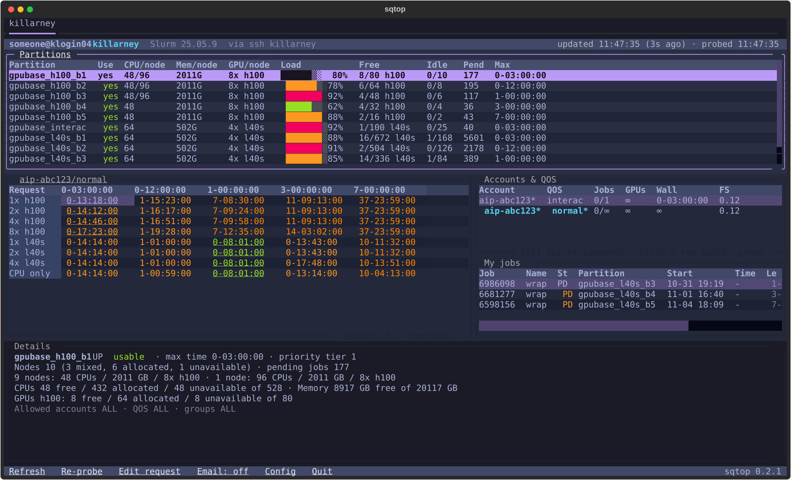

# sqtop

[](https://pypi.org/project/sqtop/)
[](https://pypi.org/project/sqtop/)
[](https://github.com/yanting-yang/sqtop/blob/main/LICENSE)

`htop` for Slurm: a terminal dashboard that answers **where can I run, under which
account/QOS, and when would my job start?**, on the cluster you are logged in to and on
any cluster you can reach over ssh.



- **Start-time estimates.** Each request size (each GPU type up to your cap, then CPU
  only) is test-submitted at every partition time limit with `sbatch --test-only`, so
  you see when 1 GPU for 3 hours would start next to 8 GPUs for a week.
- **Partitions and hardware.** Load, free GPUs and CPUs, idle nodes and pending jobs per
  partition or per kind of node, and which partitions your accounts may use.
- **Your limits.** Every account/QOS pair you can use, with its job, GPU and wall-time
  caps and your fair share, read from Slurm even where `sacctmgr` does not work.
- **Your jobs.** Running and pending jobs, with expected start times and planned nodes.
- **One click to act.** Submit any estimate's `sbatch` command, copy any command, or
  release a job, each after you confirm.
- **Several clusters in one window.** A tab per cluster over ssh, from a login node or
  from your laptop. sqtop reuses your ssh connections and never asks for a password.
- **Hourly email** of the whole report while the dashboard runs.

Everything is read from Slurm, so it works on any cluster; the few site rules Slurm
cannot report go in a [config file](#configuration).

## Quick start

You need [uv](https://docs.astral.sh/uv/), which fetches Python 3.13 if you do not have it.

```bash
uvx sqtop                 # run the latest release
uv tool install sqtop     # or install it, then run `sqtop`
sqtop > report.txt        # when output is not a terminal, print a text report once
```

- **On a Slurm login node**, sqtop shows that cluster. It needs `scontrol` and `squeue`;
  estimates need `sbatch` or `srun`.
- **On your own machine**, it opens on the `Config` form: add a cluster's name and the
  ssh host of its login node, click `Save`, and its tab opens. See
  [Remote clusters](#remote-clusters).

There are no command-line options. Probes use `--test-only`, so sqtop is safe on a
shared login node: nothing is submitted or cancelled until you confirm it in a dialog.

## Remote clusters

Every cluster with an `ssh` host in your config gets a tab. sqtop runs Slurm on its
login node through `ssh` with your `~/.ssh/config` (aliases, users, keys), contacts it
only once you open its tab, and refreshes only the visible tab. Commands there get your
login shell's Slurm setup (`PATH`, and `SLURM_CONF` where a module sets it) and run from
your `$SCRATCH`, since some clusters refuse jobs submitted from `/home`.

sqtop never asks for a password or MFA. For a cluster that needs one, let ssh share
connections and log in with `ssh` in another terminal first; sqtop reuses that
connection:

```
# ~/.ssh/config
Host *.alliancecan.ca
    ControlMaster auto
    ControlPath ~/.ssh/cm-%C
    ControlPersist 4h
```

The connection then stays open for 4 hours after your last session there closes. With
keys that log in without a prompt, nothing is needed: sqtop opens its own shared
connection, which closes 10 minutes after its last use. A tab that cannot connect shows
ssh's error and how to connect; log in, then click `Refresh`.

Commands for a remote cluster are shown with its host as the prompt
(`fir.alliancecan.ca$ sbatch ...`): run them there. The text report covers the cluster
you are on, and the remote ones only where Slurm is not available.

## Using the dashboard

Each tab probes a request of 32 CPUs and 128 GB with `sbatch` at every partition time
limit; change it with `Edit request`. Where the account/QOS being probed allows fewer
CPUs or less memory, the request is brought down to that cap, and the estimates note
`capped by its limits`. The visible tab refreshes every minute and re-probes every
five. There are no keyboard shortcuts: everything is a click, and each dialog closes
with its own buttons.

| Click | Action |
| --- | --- |
| a cluster tab | Show that cluster |
| a row or cell | Select it; the Details panel follows the selection |
| a highlighted Accounts & QOS row | Probe with that account/QOS |
| the Partitions title | Switch between Partitions and Nodes by hardware (a single-node cluster has one Hardware table instead) |
| the account/QOS above the estimates | Probe with the next account/QOS |
| the command under the estimates | Switch between `sbatch` and `srun` probes |
| `Submit` in Details | Submit the selected `sbatch` request, after you confirm |
| `Copy` after a command in Details | Copy that command |
| `Release` in a job's Details | Release the job with `scancel`, after you confirm |
| `Refresh` / `Re-probe` | Refresh everything / re-probe now |
| `Edit request` | Edit the probe request: whole node, CPUs, memory, walltimes, extra options such as `--partition` or `--constraint`, and the job email address |
| `Email: off` / `Email: on` | Email the report now and every hour until you quit / stop |
| `Config` | Edit the [config](#configuration) in a form; saving applies it at once |
| `Quit` | Quit |

The bottom bar also shows which version of sqtop is running.

## Reading the dashboard

- **Partitions.** `Use` says whether your accounts, QOS and Unix groups may submit
  there. `CPU/node`, `Mem/node` and `GPU/node` describe each node (CPUs exclude reserved
  cores; two kinds of node show as `48/96`). `Load` is the share of GPUs (CPUs on
  CPU-only partitions) in use: `█` allocated, `▒` unavailable (down, drained, reserved),
  `░` free. `Free` is free/total per GPU type, `Idle` counts wholly idle nodes, `Pend`
  counts everyone's pending jobs, and `Max` is the time limit.
- **Hardware**, in place of Partitions on a cluster with a single node. Its partitions
  all share that node, so Slurm reports the same hardware for each; the table has one
  row per resource instead: CPUs, memory, then each GPU type. `Load` and `Free` are as
  above. `Pend` counts everyone's pending jobs asking for that GPU type, and on the
  CPUs row those asking for no GPU; every job asks for memory, so its row shows `-`.
  `Max` is the longest time limit of the partitions you can use. Details list the
  partitions with their time limits, pending jobs and allowed QOS.
- **Start estimates**, titled with the account/QOS probed. Rows are request sizes,
  written as `--gpus-per-node` takes them (`h100:4`), columns are walltimes, and each
  cell is how long until the scheduler expects the job to start: `now`, a wait such as
  `0-10:54:00`, `no` when it cannot run (Details gives the reason), or `-` above the
  account/QOS wall-time cap. The earliest start in each row is underlined. A longer job
  can start sooner: in the screenshot a 3-day L40S job beats a 12-hour one, since
  12-hour jobs queue in the much busier `b2` partition.
- **Accounts & QOS.** Every account/QOS pair you can submit under. `*` marks what
  commands leave out because Slurm picks it anyway. `Jobs` is your running jobs over the
  tightest per-user cap, `GPUs` and `Wall` are the tightest GPU and wall-time caps from
  any scope, and `FS` is your fair-share factor. `∞` means no cap, `?` unknown.
- **My jobs.** Your queued and running jobs. `Start` is when a job started, or when the
  scheduler expects a pending one to; `Nodes` is where it runs, or the nodes planned for
  a pending job (dimmed, as they can still change); `Reason` is why it waits.
- **Details** follows the selection, and scrolls when there is more than fits (a QOS
  with many limits). For an estimate it shows the partition the job
  would land in, the probe with the scheduler's reply, and the command to submit the
  same request, each with `Copy`. For a job it shows the command that attaches a shell
  to it (`srun --jobid=<id> --overlap --pty <shell>`) and the one that releases it.

Submitted jobs hold their allocation with `sleep infinity` until the time limit and
write no output file (`--output=/dev/null`). An `srun` command opens an interactive
shell, so it cannot be submitted from the dashboard: copy it and run it in a terminal.

## Configuration

All settings live in `~/.config/sqtop/config.toml` (`$XDG_CONFIG_HOME/sqtop/config.toml`
if you set that). Click `Config` to edit it in a form; `Save` checks the settings, writes
the file privately (`chmod 600`, since it can hold an SMTP password) and applies what
changed without a restart. The file is plain TOML, so you can also edit it by hand.

### Clusters

Partitions, GPU types, time limits, accounts and limits all come from Slurm, and GPU
types are shown exactly as Slurm names them. A cluster profile records only an ssh host
and the rules Slurm cannot report, keyed by the cluster name (`ClusterName` in
`scontrol show config`):

| Setting | Values | Effect |
| --- | --- | --- |
| `ssh` | a host or `~/.ssh/config` alias | A tab for the cluster from anywhere |
| `gpu_counts` | `pow2` (default: 1, 2, 4, ...), `all`, `whole_node`, `one_or_node` | GPU counts to probe. `whole_node` probes only whole nodes and asks for all of their CPUs and memory (`--exclusive --mem=0`); `one_or_node` probes 1 GPU and the whole node |
| `resources` | `request` (default), `by_gpu` | `by_gpu` leaves `-c`/`--mem` out of GPU requests, for sites that size them by GPU and refuse `--mem` |

These clusters have been checked with sqtop:

| Cluster | Profile |
| --- | --- |
| Fir, Killarney, Narval, Nibi, Vulcan | `ssh` only |
| Tamia | `gpu_counts = "whole_node"`: GPUs are allocated by whole node |
| Trillium GPU | `gpu_counts = "one_or_node"`, `resources = "by_gpu"`: one GPU or whole nodes, with CPUs and memory by GPU |
| RCL | `gpu_counts = "all"`; it is one node, so it shows the Hardware table |

```toml
[clusters.fir]
ssh = "fir.alliancecan.ca"

[clusters.tamia]
ssh = "tamia.alliancecan.ca"
gpu_counts = "whole_node"

[clusters.trillium-gpu]             # Trillium's GPU subcluster has its own login node
ssh = "trillium-gpu.alliancecan.ca"
gpu_counts = "one_or_node"
resources = "by_gpu"
```

The walltimes probed are not a setting: they are the distinct time limits of the
partitions you can use, which is where routing changes. `Edit request` overrides them
for a session.

### Whole nodes

Tick "Whole node" in `Edit request` to probe whole nodes: every command asks for
`--exclusive --mem=0` (every CPU and all the memory) instead of `-c`/`--mem`, and the
GPU rows are each type's full node, such as `h100:8`. Where a profile sets
`gpu_counts = "whole_node"`, the GPU rows always do this and the estimates note "GPUs by
whole node"; with `resources = "by_gpu"` they note "GPU rows: CPUs and memory by GPU".

### Job emails

A `[mail]` table adds `--mail-type` and `--mail-user` to every command you submit or
copy (probes leave them out), so a job emails you when it starts, ends or fails:

```toml
[mail]
user = "you@example.com"
type = "BEGIN,END,FAIL"       # any of sbatch's --mail-type values
```

Clear the address in `Edit request` to leave email out for a session.

### Hourly email

Click `Email: off` to email the report now and every hour until you quit (click
`Email: on` to stop). Each email covers the cluster you are on and every remote tab you
have opened, and starts with your job counts and what happened since the last one:

```
killarney: 1 running, 2 pending. Since 14:00:
  6284538 (wrap) started on kn021
  6233018 (wrap) ended: TIMEOUT
  6290112 (eval) submitted (Priority), expected to start 10-17 09:30
```

The server comes from `[smtp]`:

```toml
[smtp]
server = "mail.example.org"
port = 587                       # STARTTLS; 465 for SSL
sender = "you@example.org"       # also the login
password = "..."
recipient = "you@example.org"    # default: user in [mail]
```

Every email has the subject `sqtop` and replies to the first, so your mail client keeps
them in one conversation. While the email is on, the top bar shows when the next one goes
out and marks it `(last failed)` if one could not be sent. The conversation and the jobs
last reported are kept in `~/.local/state/sqtop/mail.json`; delete it to start a new
conversation.

## Troubleshooting

- **A remote tab shows an ssh error.** Log in with `ssh` in a terminal (see
  [Remote clusters](#remote-clusters)), then click `Refresh`.
- **`srun` probes fail with "Requested operation is presently disabled".** sqtop is
  running on a compute node, such as inside an interactive job; run it on a login node.
- **Every estimate is rejected for submitting from `/home`.** On a cluster you are
  logged in to, sqtop submits from the directory you started it in: start it from
  `/scratch` or `/project`. Remote tabs already run from `$SCRATCH`.
- **`sacctmgr` fails with "Connection refused".** `slurmdbd` runs on the controller, but
  accounting is still enforced. sqtop reads limits from `scontrol show assoc_mgr`
  instead, and finds the account/QOS pairs you may use by test-submitting each one.

## Development

```bash
uv sync
uv run python -m unittest discover -s tests -t tests
uvx ruff check src tests
```

See [AGENTS.md](https://github.com/yanting-yang/sqtop/blob/main/AGENTS.md) for the code
layout and the Slurm quirks of the sites sqtop runs on.

To release, bump the version and push a tag for it. The
[release workflow](https://github.com/yanting-yang/sqtop/blob/main/.github/workflows/release.yml)
builds the package, publishes it to PyPI and creates the GitHub release, with the tag
message's body as its notes:

```bash
uv version --bump patch          # or minor/major; updates pyproject.toml and uv.lock
git commit -am "Release $(uv version --short)"
git tag -a "v$(uv version --short)" -m "sqtop $(uv version --short)" -m "What changed..."
git push origin main "v$(uv version --short)"
```

## License

MIT; see [LICENSE](https://github.com/yanting-yang/sqtop/blob/main/LICENSE). sqtop is
inspired by [hunoutl/slurmtop](https://github.com/hunoutl/slurmtop) and
[slmtop](https://github.com/dawnmy/slmtop).
